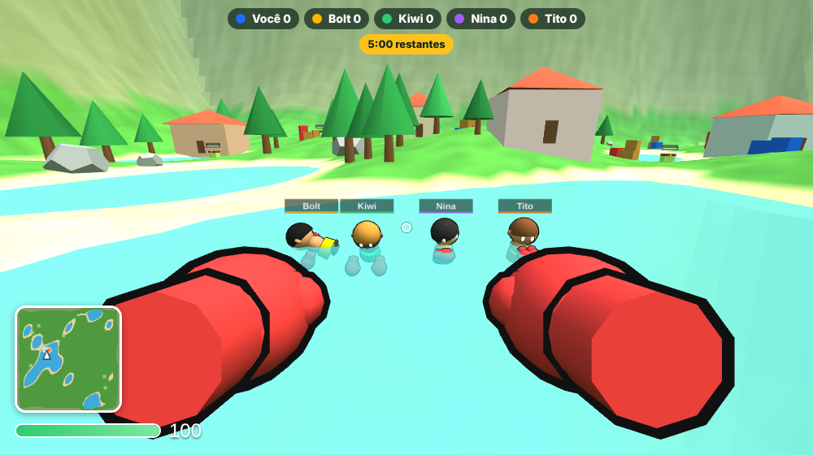

# Uppercut!

Jogo de boxe em primeira pessoa num mapa aberto, feito com Three.js. Você luta contra CPUs ou contra um amigo na mesma tela, abre baús escondidos e coleciona 50 luvas especiais.



## Como jogar

Abra o link do GitHub Pages, ou abra o `index.html` no navegador (Chrome, Edge ou Firefox). Não precisa instalar nada.

### Instalar como aplicativo

Pelo link do GitHub Pages, o jogo pode ser instalado e ganha ícone próprio:

- **Chrome ou Edge no computador:** clique no ícone de instalar na barra de endereço (um monitor com uma setinha) ou abra o menu ⋮ e escolha **Instalar Uppercut!**.
- **Android:** no Chrome, abra o menu ⋮ e toque em **Instalar app** ou **Adicionar à tela inicial**.
- **iPhone/iPad:** no Safari, toque em Compartilhar e depois em **Adicionar à Tela de Início**.

Depois de aberto uma vez, o jogo também funciona sem internet.

Também dá para rodar com um servidor local:

```bash
npx serve .
```

### Controles

| Ação | Teclado e mouse | Controle de videogame |
|---|---|---|
| Andar | W A S D | analógico esquerdo |
| Olhar | mouse | analógico direito |
| Soco | clique esquerdo | RT |
| Soco forte | clique direito | RB |
| Defender | Q (segurar) | LT |
| Pular / nadar para fora | Espaço | A |
| Correr / nadar rápido | Shift | L3 |
| Pausar | Esc | |

No modo **Amigo na mesma tela**, o Jogador 2 usa o controle ou o teclado: I J K L para andar, setas para olhar, Enter para socar, Shift direito para o soco forte, P para defender e O para pular.

## O que tem no jogo

- **3 modos:** contra CPUs (até 30), amigo na mesma tela (tela dividida) e online com amigos.
- **11 mapas:** Ilha Verde (pequena) e 10 mapas gigantes: Floresta Gigante, Deserto Dourado, Montanhas Nevadas, Arquipélago Tropical, Vale do Vulcão, Campo de Flores, Cânion Vermelho, Floresta de Outono, Pântano dos Cogumelos e Terra dos Doces.
- **Lutas por tempo:** 3, 5, 10 ou 15 minutos. Ganha quem tiver mais nocautes.
- **50 luvas especiais** em 4 raridades (comum, rara, épica e lendária), dentro de baús que precisam de muitos socos para abrir. As mais raras ficam no alto dos morros e no meio dos lagos. As luvas encontradas podem ser escolhidas como luva padrão na Coleção.
- **Natação:** os lagos são fundos e você precisa nadar.
- **Minimapa** com adversários e baús.

### Combos

| Combo | Como fazer |
|---|---|
| Gancho Duplo | soco, soco, forte |
| Metralhadora | 4 socos (segure o soco para continuar, até 4 s) |
| Martelo | forte, forte |
| Furacão | soco, forte, soco, forte (segure o soco para continuar, até 5 s) |
| Meteoro | pule e dê um soco forte no ar |
| Contra-ataque | defenda um golpe e solte um soco forte |
| Soco Voador | correndo, soco forte |
| Tubarão | na água, nadando rápido, soco forte |
| Onda Gigante | na água: forte, forte |
| Redemoinho | na água: soco, forte, soco, forte |
| Rajada de Bolhas | na água: 4 socos |
| Salto do Golfinho | pule para fora da água e dê um soco forte no ar |

Cada golpe seguido sem apanhar aumenta sua força em 5%, até +50%.

## Publicar no GitHub Pages

1. Crie um repositório e envie os arquivos desta pasta.
2. No repositório, vá em **Settings → Pages**.
3. Em **Source**, escolha a branch `main` e a pasta `/ (root)` e salve.
4. Depois de um ou dois minutos, o jogo fica disponível em `https://SEU-USUARIO.github.io/NOME-DO-REPOSITORIO/`.

## Sobre o modo online

O modo **Online com amigos** usa os recursos de sala ao vivo do Claude e só funciona quando o jogo é aberto como página do Claude. Fora do Claude (no GitHub Pages ou abrindo o arquivo direto), esse modo mostra um aviso, e os outros dois modos funcionam normalmente.

A coleção de luvas, a luva padrão, o apelido e o último mapa escolhido ficam salvos no navegador (localStorage).

## Arquivos

- `index.html`: o jogo inteiro (HTML, CSS e JavaScript num arquivo só)
- `manifest.webmanifest`, `sw.js`, `icon-192.png`, `icon-512.png`: arquivos que deixam o jogo instalável como aplicativo
- `screenshot.png`: imagem do jogo usada neste README

O Three.js (versão r128) e as fontes (Lilita One e Nunito) são carregados pela internet na primeira vez que o jogo é aberto.
